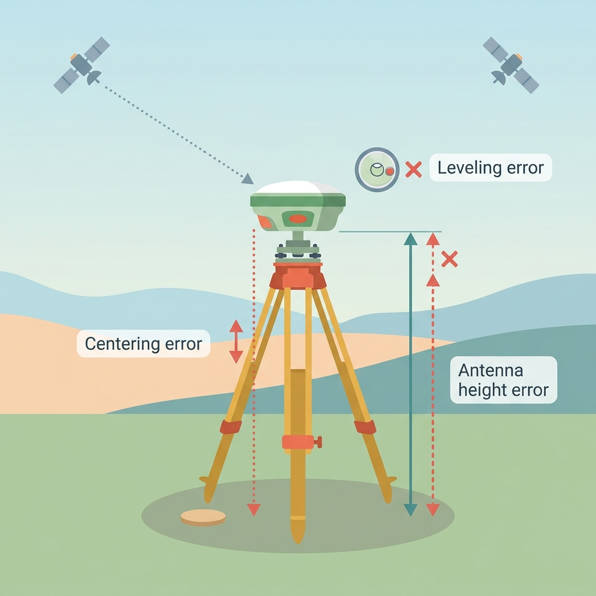

# Module 2 — Where Errors Come From

_Read time: 6–8 minutes_

**By the end of this module, you can:** name what throws off a GNSS
position, explain what the satellites' ground control fixes versus what
a reference (base) station fixes, tell whether a correction can fix a
problem or whether you have to fix it at your antenna, and name the
three kinds of reference station you might use.

## 2.1 What Throws Off a Position

Ten things can push a GNSS position away from the truth. Four happen
on the signal's way down from space, three happen around your antenna,
and three are setup mistakes. Each table says where the error comes
from and what you can do about it.

### Errors on the way down (items 1–4)

The signal travels about 20,000 km from satellite to receiver. Four things go wrong along the way.

{ .hub-img .hub-zoom width="70%" }

Figure 2.1.1: Satellite and atmosphere errors
{ .figure-caption }

<table>
  <thead>
    <tr>
      <th scope="col" class="gnss-mark-cell">#</th>
      <th>Error</th>
      <th>Where it comes from</th>
      <th>What you can do</th>
    </tr>
  </thead>
  <tbody>
    <tr>
      <td class="gnss-source" colspan="4">Satellite</td>
    </tr>
    <tr>
      <td class="gnss-mark-cell">1</td>
      <td>Satellite clock error</td>
      <td>Your receiver turns signal travel time into distance, so even a tiny timing slip in the satellite's clock (a few billionths of a second) becomes meters of error.</td>
      <td>Mostly fixed for you by the clock data in the satellite's own signal (see 2.2).</td>
    </tr>
    <tr>
      <td class="gnss-mark-cell">2</td>
      <td>Orbit error</td>
      <td>Your receiver measures from where the satellite says it is. If the satellite is slightly somewhere else, that difference ends up in your position.</td>
      <td>Mostly fixed by the orbit data in the signal (see 2.2). Correction services reduce what's left.</td>
    </tr>
    <tr>
      <td class="gnss-source" colspan="4">Atmosphere</td>
    </tr>
    <tr>
      <td class="gnss-mark-cell">3</td>
      <td>Ionospheric delay</td>
      <td>The upper atmosphere slows the signal. The delay changes with time of day and solar activity, and it is usually the biggest atmospheric error.</td>
      <td>Use a dual-frequency receiver (most modern ones are). It largely cancels this error.</td>
    </tr>
    <tr>
      <td class="gnss-mark-cell">4</td>
      <td>Tropospheric delay</td>
      <td>Water vapor, pressure, and temperature in the lower atmosphere slow the signal. Satellites low on the horizon are worse, because their signal crosses more air.</td>
      <td>A second frequency does not help. A nearby base station or correction service does.</td>
    </tr>
  </tbody>
</table>

Left alone, these can add several meters of error.

### Errors around your antenna (items 5–7)

Even a clean signal can be disturbed in its last few meters.

{ .hub-img .hub-zoom width="70%" }

Figure 2.1.2: Errors around the receiver
{ .figure-caption }

<table>
  <thead>
    <tr>
      <th scope="col" class="gnss-mark-cell">#</th>
      <th>Error</th>
      <th>Where it comes from</th>
      <th>What you can do</th>
    </tr>
  </thead>
  <tbody>
    <tr>
      <td class="gnss-mark-cell">5</td>
      <td>Signal obstruction</td>
      <td>Trees, buildings, and canyon walls block or weaken signals. Your receiver sees fewer satellites, and the ones it does see are bunched together, which gives a weaker position.</td>
      <td>Move to where more sky is open. A correction cannot fix this.</td>
    </tr>
    <tr>
      <td class="gnss-mark-cell">6</td>
      <td>Multipath</td>
      <td>The signal bounces off a nearby surface (glass wall, water, vehicle) before reaching you. The bounced path is longer than the direct one, so the distance comes out wrong. Common in cities.</td>
      <td>Keep the antenna away from large reflective surfaces. A correction cannot fix this.</td>
    </tr>
    <tr>
      <td class="gnss-mark-cell">7</td>
      <td>Receiver noise</td>
      <td>Tiny random electronic noise inside the receiver. It limits accuracy even under a perfect open sky.</td>
      <td>It is small and random, so staying on the point a little longer averages it down. A correction cannot fix it.</td>
    </tr>
  </tbody>
</table>

No correction can remove these. They happen at your antenna, so the fix
is where and how you set up.

### Setup mistakes (items 8–10)

Good satellites and good corrections cannot rescue a setup mistake.

{ .hub-img .hub-zoom width="70%" }

Figure 2.1.3: User setup errors
{ .figure-caption }

<table>
  <thead>
    <tr>
      <th scope="col" class="gnss-mark-cell">#</th>
      <th>Error</th>
      <th>Where it comes from</th>
      <th>What you can do</th>
    </tr>
  </thead>
  <tbody>
    <tr>
      <td class="gnss-mark-cell">8</td>
      <td>Centering error</td>
      <td>The antenna is not exactly over the survey mark, so every position carries that offset.</td>
      <td>Place the antenna right over the mark.</td>
    </tr>
    <tr>
      <td class="gnss-mark-cell">9</td>
      <td>Leveling error</td>
      <td>If the pole or tripod leans, the antenna is not directly above the point and the result shifts sideways.</td>
      <td>Check the bubble before you start, and again before you save the point.</td>
    </tr>
    <tr>
      <td class="gnss-mark-cell">10</td>
      <td>Antenna height error</td>
      <td>The receiver measures at the antenna, not the ground. The height from ground to antenna must be measured and entered correctly.</td>
      <td>Measure it, enter it, and check the units (meters vs. feet). A wrong value gives a wrong elevation.</td>
    </tr>
  </tbody>
</table>

Check the mark, the bubble, and the antenna height before every measurement.

## 2.2 Ground Control: Why Satellite Errors Are Already Small

Satellite clock and orbit errors (items 1 and 2) are already being fixed
before your receiver sees the signal, though not perfectly.

Every satellite system has a **ground control** network: tracking
stations run by whoever operates it (the U.S. Space Force for GPS).
They watch each satellite, check where it really is and what its clock
really reads, and send updated information up to it. The satellite adds
that information to the signal it is already broadcasting.

**Your receiver uses this automatically**, and so does every other
receiver, whether a rover, a base station, or a phone. There is nothing
to connect or switch on.

That is why these errors are typically around a meter, not kilometers,
even with no correction service running. They are not zero because the
satellite's information is a forecast made ahead of time. The longer
since the last update, the more the satellite drifts from its forecast.
Ground control also does nothing about the atmosphere over your site
(the signal carries only a rough built-in estimate). That is left to a
reference station, covered next.

**Think of it as two layers:**

- **Ground control:** built into the signal, helps every receiver on
  Earth, and gets satellite errors down to roughly a meter.
- **Reference station:** fixes what is left, live, for receivers near it.

The correction methods in Module 5 work on top of this first layer.

## 2.3 What a Reference Station Does

A **reference station** (also called a **base station**, same thing) is
a GNSS receiver sitting on a spot whose exact position is already known.

Because it knows where it really is, it can check its own GNSS reading
against the truth. The difference is the error. It sends that out (or
the raw data needed to work it out), and your receiver applies the same
fix to its own readings.

**Why this works for you:** if the base is nearby, its signals traveled
through nearly the same sky as yours, so it is wrong in nearly the same
way you are. The farther away it is, the less that holds.

## 2.4 Three Kinds of Reference Station

All three do the same job: compare a known position to a live reading
and report the difference. They differ in who runs the station and
whether it stays in place.

**Public / CORS.** **CORS** stands for **Continuously Operating
Reference Station**: a permanent station that runs around the clock, so
you don't have to set up your own. It usually means the free networks
run by government and universities, such as NGS's national network and
many state DOT networks. This is where your organization mostly gets the
base data used for PPK (Module 7).

**Commercial network.** A paid subscription, such as Leica SmartNet or
Trimble VRS. These are usually denser than the public network in
populated areas. Many create a "virtual" base station near wherever you
are standing, instead of using one fixed physical station. Module 5
calls this **Network RTK**.

**Your own second receiver.** You set up a second receiver yourself on a
known point (or survey one in) and use it as a temporary base for that
session. When you pack up, it is gone. Module 5 covers setup, including
the radio link between the two receivers.

## 2.5 Which Errors a Correction Can Fix

A reference station can only report an error it also experiences. That
sorts all ten errors into two groups:

**Shared** (the base sees it too, so a correction can fix it): satellite
clock error, orbit error, and, when the base is reasonably close,
ionospheric and tropospheric delay. **(Items 1–4)**

**Local** (happens only at your antenna, so no base station anywhere can
see it): obstruction, multipath, receiver noise, and all three setup
mistakes. **(Items 5–10)**

_A base station cancels errors that both receivers share because their
signals crossed the same sky. It cannot touch an error that happens only
at one antenna._

This is why every correction method (DGNSS, RTK, PPP, PPK) has the same
limit: none of them can fix local errors. **What to do in difficult
multipath or obstructed places is covered in Module 6 (Hard Places).**

| **WHY IT MATTERS** |
|---|
| When a reading looks bad, ask one question: is the cause shared or local?  **Shared:** check your correction source. Is it connected, close enough, and working?  **Local:** no correction will help. Fix it at your antenna: move to open sky, step away from reflective surfaces, re-level, re-center, or re-measure the height. |

### Self-Check

Try explaining each of these out loud before moving on. If one doesn't
come easily, that's the concept to revisit:

**Q1. Which set contains only real sources of GNSS error?**

<ul class="sc-options">
  <li data-key="a">Satellite clock, orbit, ionospheric delay, WAAS, multipath</li>
  <li data-key="b">Satellite clock, orbit, ionospheric delay, tropospheric delay, multipath, receiver noise, signal obstruction</li>
  <li data-key="c">Base station, radio interference, DOP, multipath, receiver noise</li>
  <li data-key="d">Datum mismatch, antenna height, multipath, ground control, orbit</li>
</ul>

WAAS is a correction system, DOP is a measure of satellite geometry, and ground control is a fix, not an error.

**Q2. What does a reference (base) station do?**

<ul class="sc-options">
  <li data-key="a">Adds extra satellites to your count</li>
  <li data-key="b">Uploads corrected clock and orbit data to the satellites</li>
  <li data-key="c">Compares its known position to its live GNSS reading and reports the difference as error</li>
  <li data-key="d">Removes multipath from your antenna</li>
</ul>

It knows where it really is, so whatever its live reading is off by is error. Nearby receivers can apply the same fix.

**Q3. Why can a correction remove some errors but not others?**

<ul class="sc-options">
  <li data-key="a">It can only remove an error the reference station also experiences</li>
  <li data-key="b">It can only remove errors smaller than 1 cm</li>
  <li data-key="c">It can only remove errors that happen at night</li>
  <li data-key="d">It can only remove errors the receiver has already logged</li>
</ul>

A base station cancels what it and your rover both see, and nothing else.

**Q4. Which three errors are local, so no reference station can correct them?**

<ul class="sc-options">
  <li data-key="a">Satellite clock error, orbit error, ionospheric delay</li>
  <li data-key="b">Tropospheric delay, ionospheric delay, orbit error</li>
  <li data-key="c">Satellite clock error, multipath, receiver noise</li>
  <li data-key="d">Multipath, receiver noise, signal obstruction</li>
</ul>

These happen only at your antenna and its surroundings. Setup mistakes (centering, leveling, antenna height) are local too.

**Q5. How does ground control differ from a reference station?**

<ul class="sc-options">
  <li data-key="a">Ground control corrects your rover live; a reference station corrects the satellites</li>
  <li data-key="b">Ground control improves each satellite's own signal for every receiver, getting errors down to roughly a meter; a reference station fixes what's left, live, for nearby receivers</li>
  <li data-key="c">They are the same thing under different names</li>
  <li data-key="d">Ground control is only used with PPK; a reference station is only used with RTK</li>
</ul>

They are two layers. Ground control's information rides on the normal satellite signal, and the reference station handles part of what remains.

**Q6. Which of these is NOT a kind of reference station?**

<ul class="sc-options">
  <li data-key="a">Public / CORS station</li>
  <li data-key="b">Commercial network</li>
  <li data-key="c">A satellite in a GNSS constellation</li>
  <li data-key="d">Your own second receiver</li>
</ul>

The three real types do the same job and differ in who runs them and how long they stay in place. Satellites are not reference stations.

**Q7. Your readings jump around next to a glass building, even with a good correction service connected. What should you do?**

<ul class="sc-options">
  <li data-key="a">Switch to a different correction service</li>
  <li data-key="b">Move the antenna away from the reflective surface, or to more open sky</li>
  <li data-key="c">Wait for ground control to send an update</li>
  <li data-key="d">Re-enter the antenna height</li>
</ul>

This is multipath, a local error. No correction can fix it, so the fix is at your antenna.

